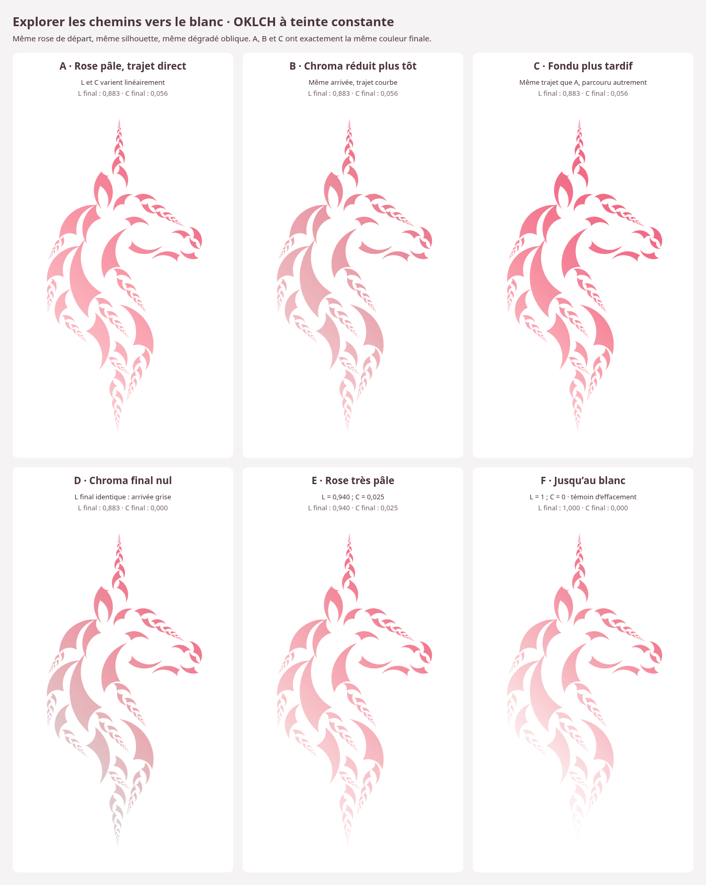
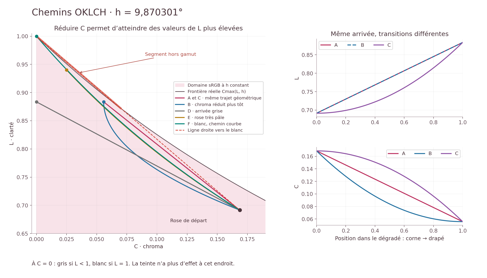

# Explorer les chemins vers le blanc

La silhouette approuvée de l’étude 06 est strictement conservée. Tous les
dessins partent du rose d’étude `#f06884`, sur fond blanc, avec le même
dégradé oblique du haut à droite vers le bas à gauche. Toutes les trajectoires
sont calculées en **OKLCH à teinte constante : h = 9,8703014704°**.

Le point de départ est `L = 0,691531639356`, `C = 0,168686857316`.
Ce rose d’étude reste distinct du rose de la palette officielle, non modifiée.

## Les six dessins

| Essai et SVG | Arrivée (L, C) | Ce qui change |
| --- | --- | --- |
| [A — rose pâle, trajet direct](A-lineaire-pale.svg) | (0,883479 ; 0,055761) | L augmente et C diminue linéairement. |
| [B — chroma réduit plus tôt](B-chroma-tot.svg) | Même arrivée que A | Le trajet courbe désature davantage les zones intermédiaires. |
| [C — fondu plus tardif](C-fondu-retarde.svg) | Même arrivée que A | Le même trajet que A est parcouru plus lentement au début, puis plus vite : davantage de rose demeure dans la crinière. |
| [D — chroma final nul](D-gris-clair.svg) | (0,883479 ; 0) | La fin devient grise, pas blanche : L reste inférieur à 1. |
| [E — rose très pâle](E-courbe-tres-pale.svg) | (0,94 ; 0,025) | Le chemin courbe suit la disponibilité du chroma dans le gamut. |
| [F — jusqu’au blanc](F-courbe-blanc.svg) | (1 ; 0) | Le chemin courbe atteint le blanc : témoin d’effacement complet. |

A, B et C ont **exactement les mêmes couleurs aux deux extrémités**. Leurs
différences viennent exclusivement du parcours. D, E et F explorent d’autres
arrivées. F est un témoin de comparaison, pas un remplacement du drapé visible.

Chaque SVG possède un PNG de même nom. Sur GitHub, ouvrir le SVG puis utiliser
**Download raw file** pour le télécharger.

## L = 0,88 n’est pas une limite absolue

À teinte constante, la clarté maximale dépend du chroma conservé :

| C fixé | L maximal en sRGB, environ |
| --- | --- |
| 0,168687 — rose de départ | 0,733506 |
| 0,055761 — rose pâle | 0,895697 |
| 0,025 — rose très pâle | 0,950826 |
| 0 | 1 |

Ces limites concernent ce rose isolé, pas le gamut commun aux huit teintes de
la palette. À C = 0, h n’a plus d’effet : L < 1 donne un gris et L = 1 le blanc.
Réduire C permet donc d’augmenter L davantage ; cela ne l’augmente pas à lui seul.

## Les chemins ne sont pas tous admissibles

Le graphique est aussi disponible en [SVG](chemins-oklch.svg).

La ligne droite A vers le rose pâle reste entièrement dans le gamut. En
revanche, la ligne droite reliant le même départ au blanc à h constant en
sort légèrement : R linéaire atteint environ **1,01123**, au lieu de rester
au plus à 1. Les deux extrémités valides ne suffisent donc pas à garantir
que tout le trajet le soit. La courbe F résout ce problème sans clipping.

Un autre essai rejeté réduisait C trop tard, avec L linéaire et une progression
de C en t². Son R linéaire atteint environ **1,06725**. Il n’est pas rendu sur
une licorne, pour ne pas présenter une version implicitement écrêtée.

L’ancien fondu de l’étude 10 suivait un mélange sRGB vers le blanc : sa teinte
variait légèrement. Les présents essais conservent h et contrôlent le gamut
le long des trajectoires OKLCH.

## Règles utilisées

`t` va de 0 à 1 le long du dégradé oblique. `L0, C0` sont les valeurs de
départ. Pour A, B et C, `Lf = 0,8834787981302322` et
`Cf = 0,05576125618779773`.

- **A** : `L(t) = L0 + (Lf − L0)t` ; `C(t) = C0 + (Cf − C0)t`.
- **B** : même L ; `C(t) = C0 + (Cf − C0)(2t − t²)`.
- **C** : appliquer les deux formules de A à `t²`. Le lieu géométrique dans
  le plan L–C est identique à A ; sa répartition sur le dessin diffère.
- **D** : mêmes formules que A, avec `Cf = 0`.
- **E** : L varie linéairement jusqu’à 0,94. On calcule `Cmax(L, h)` avec
  la conversion vers sRGB linéaire et la dichotomie existantes du projet.
  `r0 = C0 / Cmax(L0, h)` et `r1 = 0,025 / Cmax(0,94, h)`.
  On pose `r(t) = r0 + (r1 − r0)t`, puis `C(t) = r(t) Cmax(L(t), h)`.
- **F** : L varie linéairement jusqu’à 1 ;
  `C(t) = r0 Cmax(L(t), h)`. C converge vers 0 lorsque L atteint 1.

Pour E et F, les rapports restent entre 0 et 1 : les chemins conservent
une fraction admissible du chroma maximal, au lieu d’écrêter des canaux RGB.

## Calcul et vérification

Les conversions et frontières réutilisent directement `Palette.Couleurs` et
`MrJam.OKLab`, compilés dans un petit outil Elm de travail. Aucun moteur
colorimétrique supplémentaire n’est ajouté au site.

Chaque chemin est évalué en 1 001 points. Pour les parcours polynomiaux, les
extrema des trois canaux sRGB linéaires sont également vérifiés entre ces
points. Les parcours E et F sont construits à partir de la frontière réelle.

Chaque SVG factorisé utilise 501 stops calculés en OKLCH puis convertis en
sRGB. Les lecteurs SVG interpolent en sRGB entre ces stops très rapprochés :
c’est une approximation du trajet OKLCH, pas sa définition. L’écart mesuré
aux milieux des segments reste inférieur à **0,0000003 en distance OKLab**
pour les six dessins. Tous les stops sont admissibles et leurs segments
sRGB restent dans le cube sRGB. Aucun clipping.

Contrôles supplémentaires : masque, contours et transformations identiques,
teinte constante dans les calculs, L croissant et C décroissant, références SVG,
extrémités A/B/C identiques et rendus Chromium sans erreur.

[Paramètres et résultats numériques](parametres.json) ·
[Rapport de vérification](verification.json).
