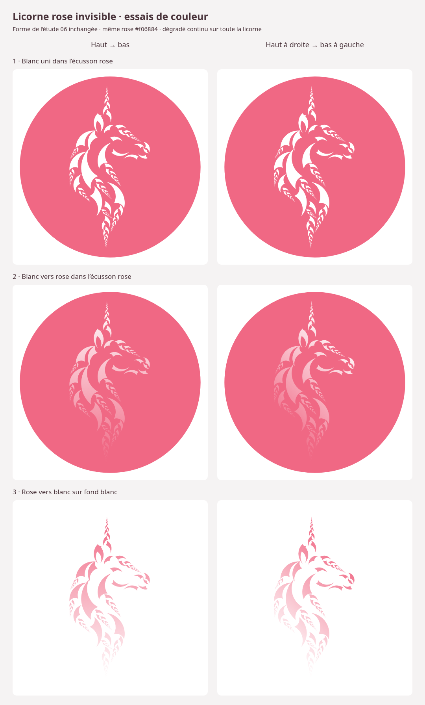

# Écusson et fondus — essais de couleur 07

La silhouette approuvée de l’[étude 06](../Licorne-fractale-06.svg) est conservée
exactement. Aucun contour, placement ou transformation de la licorne n’est modifié.
L’écusson reprend le disque rose ; les variantes sur fond blanc ont le même cadrage.

| Présentation | Haut → bas | Haut à droite → bas à gauche |
| --- | --- | --- |
| Licorne blanche dans le disque rose | [SVG blanc uni](ecusson-blanc.svg) | Même SVG, sans dégradé |
| Licorne blanche vers rose dans le disque rose | [SVG vertical](ecusson-fondu-vertical.svg) | [SVG diagonal](ecusson-fondu-diagonal.svg) |
| Licorne rose vers blanc sur fond blanc | [SVG vertical](rose-fondu-vertical.svg) | [SVG diagonal](rose-fondu-diagonal.svg) |

Pour télécharger un SVG depuis GitHub, ouvrir le fichier puis utiliser
**Download raw file**. Chaque SVG possède également un aperçu PNG de même nom.

Le rose est celui de l’étude 06 : `#f06884`. Les dégradés relient cette couleur
au blanc, sans transparence ajoutée au fondu. Ils sont linéaires en sRGB,
verticaux ou diagonaux à 45°, avec des bornes calculées sur l’étendue de la
silhouette dans chaque direction. La corne reçoit le blanc le plus lumineux
sur disque rose, et le rose le plus soutenu sur fond blanc.

Un masque alpha reprend les calques factorisés inchangés pour appliquer un
seul dégradé global : il ne sculpte aucune forme et ne répète pas le fondu dans
chaque petite pièce. Les trois contours Audio, Visio et Kino restent définis
une seule fois, puis réutilisés par les mêmes références et transformations.

Vérifications : identité des calques et contours avec l’étude 06, silhouette
entièrement contenue dans le disque, SVG autonomes, références résolues et
rendus dans Chromium sans erreur. Ces fichiers sont des essais de couleur ;
ils ne remplacent pas les ressources du site.
