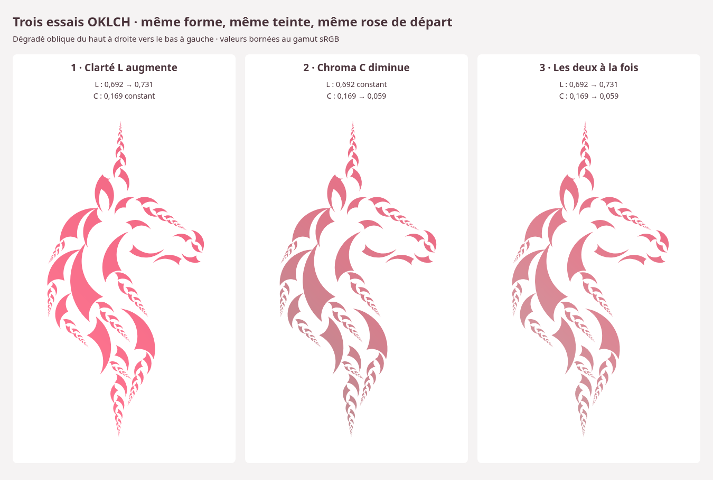

# Clarté et chroma — trois essais OKLCH

Les trois dessins conservent exactement la forme approuvée de l’étude 06,
sur fond blanc. Le dégradé oblique va du haut à droite vers le bas à gauche.

| Essai | SVG | L départ → arrivée | C départ → arrivée |
| --- | --- | --- | --- |
| L augmente, C constant | [Clarté](clarte.svg) | 0,691532 → 0,731407 | 0,168687 constant |
| C diminue, L constant | [Chroma](chroma.svg) | 0,691532 constant | 0,168687 → 0,059040 |
| L augmente et C diminue | [Les deux](clarte-chroma.svg) | 0,691532 → 0,731407 | 0,168687 → 0,059040 |

La teinte reste constante à environ 9,870301°. Les trois essais partent du
rose `#f06884` des dessins précédents. Ce rose d’étude est distinct du rose
`#f086a4` de la palette officielle ; celle-ci n’est pas modifiée.

En OKLCH, augmenter L éclaircit ; diminuer C réduit la coloration et rapproche
du gris de même clarté. Le blanc correspond à L = 1 et C = 0 : se rapprocher
du blanc demande donc à la fois davantage de clarté et moins de chroma.

À chroma constant, le rose de départ atteint sa limite sRGB vers L = 0,733506.
L’arrivée retenue utilise 95 % de la marge disponible. C est réduit à 35 %
de sa valeur initiale. L’essai combiné utilise exactement les mêmes variations
que les deux autres pour permettre leur comparaison. Une baisse de C
permettrait aussi de monter L davantage, mais ce n’est pas testé ici.

Le maximum de chroma commun aux huit teintes de la palette officielle n’est
pas le maximum propre au rose isolé. Les calculs de cette étude portent sur
le rose d’étude et réutilisent directement les modules Elm du dépôt :
`Palette.Couleurs` et `MrJam.OKLab`. Aucune nouvelle conversion n’est ajoutée
au produit.

Les dégradés suivent des trajectoires linéaires en OKLCH, approchées par
129 stops sRGB par SVG pour conserver un rendu portable. Tous les stops sont
dans le gamut, sans clipping ; les petits segments d’interpolation sRGB entre
eux restent eux aussi représentables. La silhouette factorisée sert de masque
au dégradé global et reste strictement identique.

[Paramètres numériques](parametres.json). Les aperçus PNG portent les mêmes
noms que les SVG. Pour télécharger, ouvrir le SVG dans GitHub puis choisir
**Download raw file**.

Contrôles : calculs avec les modules Elm existants compilés, invariants L/C/h,
387 stops dans le gamut, masque inchangé, références SVG et rendus Chromium.
